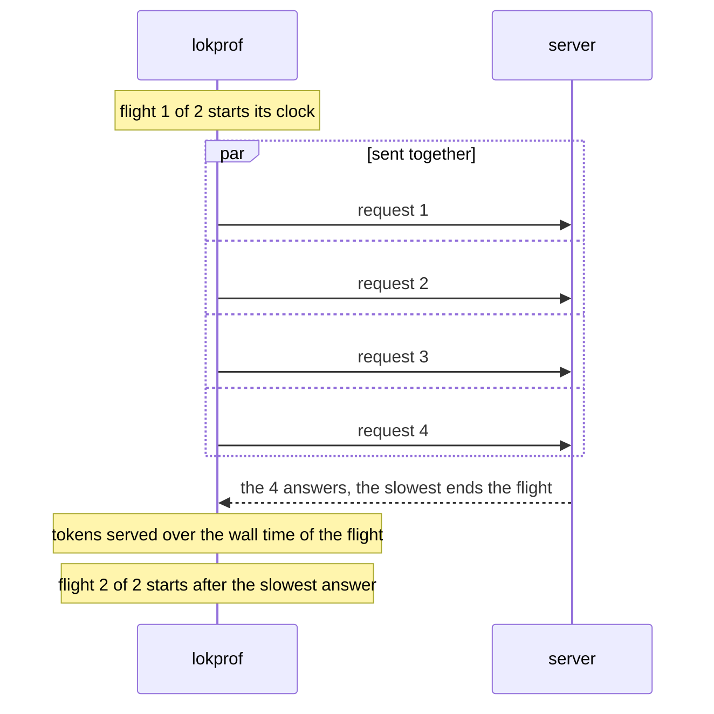

# Measure concurrent requests

Send several requests at once and get the tokens per second that the server serves in total.

## Before you start

<!-- site: widget checklist id=lokprof-concurrency-prereq -->
- [ ] An Ollama, loken or vLLM server that accepts several requests at once.
- [ ] A text model.
<!-- site: end -->

## Smallest command

```sh
lokprof --loken 11435 --models qwen3:0.6b --stream --concurrency 4 -n 8
```

`--concurrency` sets the requests in flight at once.
`-n` sets the iterations of the cell.  
lokprof cuts the iterations into flights of `--concurrency` requests, sends the requests of a flight together and waits for all of them.
8 iterations at a concurrency of 4 make 2 flights.



## Run it

<!-- site: widget steps id=lokprof-concurrency-steps -->
1. Run the sweep at a concurrency of 1, the default, to get the rate of 1 request alone.
2. Run it again at the concurrency to measure, with `-n` a multiple of it.
3. Compare the aggregate rate of each flight with the rate of 1 request.
<!-- site: end -->

## Expected result

```
  Concurrency: 4 requests in flight
  ...
  [LOKEN] Running 8 streaming iterations...
    [LOKEN] flight 1/2: 4/4 served, <n> tokens in <s>s -> <rate> tok/s aggregate
    [LOKEN] flight 2/2: 4/4 served, <n> tokens in <s>s -> <rate> tok/s aggregate
```

The aggregate rate is the tokens of every request served in the flight, over the wall time of the flight.
It appears in the output only.  
The results table and the record hold the per-request figures of every request served.

A failed request is reported and left out of the flight's tokens.
The record keeps it in `iteration_errors` as `flight N: ...`.  
A request served without a token count is left out of the total, and a line says how many were.

A flight records no energy, no card samples and no host samples.  
The record does not hold the concurrency, so keep it in the name of the file.

## Troubleshooting

| Symptom | Cause | Fix |
|---|---|---|
| `flight 1/2: 3/4 served` | 1 request of the flight failed. | Read `flight request failed: ...` above it, or `iteration_errors` in the record. |
| `... served without a token count, left out of the total` | The server did not report the tokens of a request. | Read the aggregate rate as a lower bound. |
