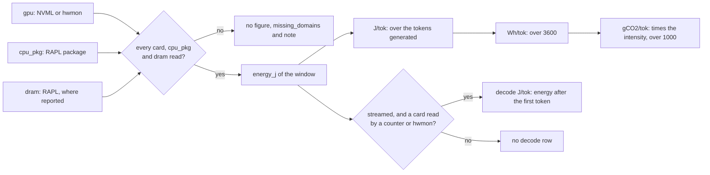

# Measure energy

Get the joules per token of every request, split between prefill and decode, with the idle draw of the machine recorded apart.

## Before you start

<!-- site: widget checklist id=lokprof-energy-prereq -->
- [ ] Linux, where the processor's counters can be read.
- [ ] The processor's counters readable by your user, as set below.
- [ ] The NVIDIA driver on a machine with NVIDIA cards.
- [ ] The machine idle apart from the server under test.
<!-- site: end -->

Outside Linux, the processor's package is never read, so no window is complete and no energy figure is stored.

## Make the processor readable

The kernel lets only root read the processor's energy counters.
The [benchmarks](https://github.com/loken-ai/benchmarks) repository delivers the command `enable-energy.sh`, which makes them readable on the machine it runs on.

<!-- site: widget tabs group=energy-access id=lokprof-energy-access -->
### Check

```sh
enable-energy.sh --check
```

Reports what the machine can measure and changes nothing.

### Install the rule

```sh
enable-energy.sh
```

Asks for `sudo`, installs a rule that keeps the counters readable across restarts, then reports.

### By hand

```sh
sudo chmod a+r /sys/class/powercap/intel-rapl:*/energy_uj
```

The change lasts until the machine restarts.
<!-- site: end -->

## Smallest command

```sh
lokprof --loken 11435 --models qwen3:0.6b --stream --idle-energy-secs 30 -o energy.json
```

Energy is measured unless `--no-energy` is given.  
`--stream` marks the first token, which splits each window into prefill and decode.  
`--idle-energy-secs` reads the machine with no request for that many seconds before the sweep.

## Expected result

```
  Sampling idle energy baseline for 30s (no request)...
  Idle baseline: <J> J over 30.0s = <W> W (gpu+cpu_pkg+dram)
  ...
    #1: <rate> tok/s, TTFT <ms>ms, <n> tokens, ITL[p50 <ms>ms p95 <ms>ms], <ms>ms total
        energy: <J> J (gpu+cpu_pkg+dram) -> <J> J/tok [gpu <J> + cpu <J>], decode <J> J/tok, <g> gCO2/tok
```

The results table of each cell gains 4 rows, each labelled with the domains it counts:

| Row | Value |
|---|---|
| `Energy J/tok [gpu+cpu_pkg+dram]` | the energy of the window over the tokens generated |
| `Energy decode J/tok [gpu+cpu_pkg+dram]` | the energy from the first token to the end, over the tokens generated |
| `Energy Wh/tok [gpu+cpu_pkg+dram]` | the first row in watt-hours |
| `Carbon gCO2/tok [gpu+cpu_pkg+dram]` | watt-hours per token times `--carbon-intensity`, over 1000 |

The record keeps the idle draw as `idle_watts` under `idle_energy_baseline`.
Every figure includes it.  
To remove it from a window, subtract `idle_watts` times the window's `duration_s` from its `energy_j`.

## What is counted

| Domain | Read from | Note |
|---|---|---|
| `gpu`, NVIDIA card | the NVML energy counter, or the NVML power integrated over the window | every NVIDIA card of the machine, not only the one the model ran on |
| `gpu`, AMD card | the hwmon energy counter, or the hwmon power integrated over the window | an AMD device under 4096 MiB of memory counts as integrated |
| `gpu`, discrete Intel card | the hwmon energy counter | a card with no counter is missing |
| integrated GPU | inside `cpu_pkg` | nothing separate to read |
| `cpu_pkg` | the RAPL package counters under `/sys/class/powercap` | Linux only, includes the operating system and lokprof |
| `dram` | the RAPL `dram` subdomain | where the processor reports one |

`gpu_sources` in each window names how each card was read.
A power reading integrated over the window is an estimate.

Each window goes from these domains to the figures of the results table:



The decode split needs `--stream` and a card read by a counter or through hwmon.  
`--concurrency` above 1 and the image, speech, music and transcription cells record no energy.

## Troubleshooting

The `note` of a window and the energy line of an iteration say what was not read.

| Symptom | Cause | Fix |
|---|---|---|
| `CPU RAPL unavailable (needs root): energy_uj is permission-denied` | The processor's counters are readable by root only. | Run `enable-energy.sh`, or the command by hand. |
| `CPU energy unavailable (no intel-rapl powercap domains)` | The kernel exposes no RAPL counter. | The processor cannot be read on this machine, and no window is complete. |
| `energy figures withheld: card1 could not be read` | A card offers no reading: an NVIDIA card without NVML, or another card without an hwmon source. | Install the driver that publishes its power or energy. |
| `GPU energy integrated from a power reading, not a counter` | The card offers no energy counter. | The figure is an estimate, and the window stays complete. |
| `Idle baseline: not measurable, ... could not be read` | The same missing domain as the iterations. | Fix the domain, then measure again. |
| No `Energy decode J/tok` row | No `--stream`, or no card read by a counter or through hwmon. | Add `--stream`. |
