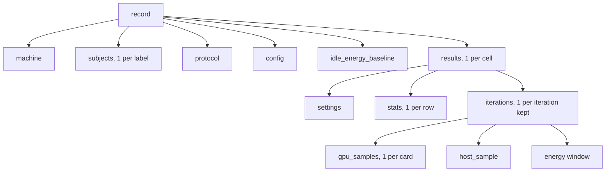

# Record

`-o FILE` writes the record of a run as 1 JSON object, at the end of the sweep.
`--output-csv FILE` writes 1 row per iteration, see [CSV file](#csv-file).

A field that lokprof could not read is `null`.
In `machine`, a field that could not be read is absent.

## Top level

| Field | Holds |
|---|---|
| `schema` | `loken/2`, the name and the major of the format |
| `timestamp` | the time the record was written, in RFC 3339, UTC |
| `machine` | the machine, see [machine](#machine) |
| `subjects` | what each server said of itself, by label, see [subjects](#subjects) |
| `protocol` | how the cells were measured, see [protocol](#protocol) |
| `config` | the options of the run, see [config](#config) |
| `idle_energy_baseline` | the idle draw, see [idle_energy_baseline](#idle_energy_baseline) |
| `results` | 1 object per cell, see [Cell](#cell) |

The major changes when a rule changes what a number means, never for a new field.
A reader compares the major and refuses a record of another one.

The objects of the record nest in this order:



The options of the run sit in `protocol` and `config`.
The settings that lokprof chose for the kind of model sit in each cell.

## machine

<!-- site: widget table id=lokprof-record-machine -->
| Field | Holds |
|---|---|
| `host_id` | 16 hex digits derived from the operating system's machine id, which stays on the host. Absent where the system has none |
| `hardware_id` | 16 hex digits derived from the cards, with their model, memory and power cap, the processor, its threads and the memory. 2 machines built alike share it |
| `cpu` | the processor, as `/proc/cpuinfo` names it |
| `threads` | the hardware threads |
| `ram_gib` | the memory, in GiB |
| `os` | the distribution |
| `kernel` | the kernel release |
| `driver` | the NVIDIA driver |
| `gpus` | 1 object per card: `index`, `uuid`, `name`, `vram_mib`, `power_cap_w` |
<!-- site: end -->

`gpus` lists the cards NVML finds.
When a server lists its devices, `gpus` lists instead the devices that server reports as available and not a processor, in its order.  
A card that NVML also knows keeps its details, and any other carries the name the server gives it.
When no card carries a `uuid`, `driver` is left out, and `hardware_id` is derived from these cards.

## subjects

1 object per target, under its label.

| Field | Holds |
|---|---|
| `url` | the address of the target |
| `says` | the answer of `/api/version` or `/version`, as the server gave it, or `null` |
| `devices` | from `/api/distributed/devices`: `devices`, a list of `type`, `backend`, `name` and `status`, and `compiled`, the features the server was built with. `null` when the server does not answer it |

## protocol

| Field | Holds |
|---|---|
| `iterations`, `warmup`, `streaming`, `max_tokens`, `unique_prompt` | the options of the run |
| `prefix_reuse_offered` | `true` when `--session-id` was given |
| `engines_seen` | the engine processes running when the record was written, among `ollama`, `lokend`, `vllm` and `llama-server` |
| `gpu_temps_c_at_start` | the temperature of each NVIDIA card before the first request, in degrees Celsius |
| `cards_by_uuid` | always `null`: which cards each engine was given is decided at its launch, outside lokprof |

## config

| Field | Holds |
|---|---|
| `models`, `num_ctx` | the lists of `--models` and `--num-ctx` |
| `prompts` | the list of `--prompts`, even when `--prompt` replaced it |
| `custom_prompt` | the text of `--prompt`, or `null` |
| `max_tokens`, `iterations`, `warmup`, `streaming`, `unique_prompt` | the options of the run |
| `gpu_sample` | `false` with `--no-gpu-sample` |
| `energy_measure` | `false` with `--no-energy` |
| `carbon_intensity_gco2_per_kwh` | `--carbon-intensity` |
| `session_id`, `num_gpu` | `--session-id` and `--num-gpu`, or `null` |

The record does not hold `--concurrency`, `--modality`, `--require-substr`, `--image`, `--audio` or `--request-timeout`.

## idle_energy_baseline

`null` unless `--idle-energy-secs` is above 0 and energy is measured.

| Field | Holds |
|---|---|
| `complete` | `true` when every card, the processor's package and the memory it reports were read |
| `missing_domains` | what could not be read: `cpu_pkg`, `dram`, or the name of a card |
| `energy_j`, `gpu_energy_j`, `cpu_pkg_energy_j`, `dram_energy_j` | the energy over the baseline, in joules. `null` when not complete |
| `duration_s` | the length of the baseline, in seconds |
| `idle_watts` | `energy_j` over `duration_s`. `null` when not complete |
| `domains_counted` | the domains that were read: `gpu`, `cpu_pkg`, `dram` |
| `note` | what was not read, and why, or `null` |

## Cell

<!-- site: widget table id=lokprof-record-cell -->
| Field | Holds |
|---|---|
| `target`, `url` | the label and the address of the target |
| `model` | the model |
| `model_fingerprint` | `modified_at`, `parameter_size` and `quantization_level` from `/api/show`, or `null` |
| `num_ctx` | the context length |
| `prompt` | the name of the prompt, or `custom` |
| `prompt_chars` | the length of the prompt in bytes, before the prefix of `--unique-prompt` |
| `load_time_ms` | the load time of the model, the same for every cell of that model |
| `first_response_preview` | the start of the first answer that held text |
| `coherence_pass` | `true` or `false`, or `null` when no answer could be judged |
| `load_error` | why the cell holds no measure: the engine could not load the model, or no iteration produced anything. `null` otherwise |
| `iteration_errors` | the error of each request that failed: `#N: ...` in sequence, `flight N: ...` with `--concurrency`, `warm-up: ...` for a media warm-up |
| `settings` | the settings lokprof chose for the kind of model, below |
| `stats` | 1 object per row of the results table, by its label: `mean`, `stddev`, `min`, `max`, `p50`, `p95`, `unit`, `count`, see [Metrics](metrics.md) |
| `iterations` | 1 object per iteration kept, see [Iteration](#iteration). Empty for image, speech, music and transcription cells |
<!-- site: end -->

| Cell | `settings` |
|---|---|
| text and vision | `{"keep_alive": "30m"}` |
| image | `{"size": [1024, 1024], "seed": 42}` |
| speech | `{"voice": "alloy"}` |
| music | `{"seconds": 5.0}` |
| transcription, or a cell that could not load | `null` |

## Iteration

<!-- site: widget table id=lokprof-record-iteration -->
| Field | Holds |
|---|---|
| `iteration` | the position among the iterations kept, from 1 |
| `wall_clock_ms`, `e2e_latency_ms` | the wall time of the request on the client's clock, in ms |
| `load_time_ms` | the load time the server reported for this request, or `null` |
| `ttft_ms` | the time to the first chunk that carried text, with `--stream`, in ms |
| `prompt_tokens` | the prompt tokens the server reported |
| `prompt_tok_s` | the prefill rate the server reported, Ollama and loken only |
| `completion_tok_s` | the rate of `Completion tok/s`, see [Metrics](metrics.md#text-and-vision-rows) |
| `server_decode_tok_s` | `eval_count` over `eval_duration`, as Ollama or loken reported them. `null` on vLLM |
| `tokens_generated` | the tokens generated |
| `inter_token_latencies_ms` | every gap between chunks that carried text, with `--stream`, in ms |
| `response_preview` | the first 120 characters of the answer, spaces collapsed, ended by `...` when cut |
| `degenerate` | `true` when the whole answer loops or is made of raw byte tokens |
| `gpu_samples` | 1 object per NVIDIA card: `gpu_index`, `gpu_name`, `vram_peak_mb`, `vram_avg_mb`, `util_peak_pct`, `util_avg_pct`, `power_peak_w`, `power_avg_w`, `samples` |
| `host_sample` | the engine processes: `procs`, the names of `--host-proc-names`, then `rss_peak_mb`, `rss_avg_mb`, `swap_peak_mb`, `cpu_avg_pct`, `cpu_peak_pct`, `samples`. `null` when no sample found a matching process |
| `energy` | the [energy window](#energy-window) of the request, or `null` |
<!-- site: end -->

A failed request leaves no iteration, and its error goes to `iteration_errors`.  
With `--concurrency` above 1, `gpu_samples` is empty, and `host_sample` and `energy` are `null`.

## Energy window

<!-- site: widget table id=lokprof-record-energy -->
| Field | Holds |
|---|---|
| `complete` | `true` when every card, the processor's package and the memory it reports were read |
| `missing_domains` | what could not be read: `cpu_pkg`, `dram`, or the name of a card |
| `energy_j` | the energy of the domains read, in joules. `null` when not complete |
| `gpu_energy_j`, `cpu_pkg_energy_j`, `dram_energy_j` | the energy of each domain, in joules. `null` when not complete |
| `duration_s` | the length of the window, in seconds |
| `j_per_tok`, `wh_per_tok`, `gco2_per_tok` | the energy per token generated, in joules, watt-hours and grams of CO2eq. `null` when not complete |
| `carbon_intensity_gco2_per_kwh` | `--carbon-intensity` |
| `gpu_path` | `nvml_counter`, `power_integration` or `none` |
| `gpu_sources` | how each card was read: `nvml_counter`, `nvml_power`, `amdgpu_hwmon_counter`, `amdgpu_hwmon_power`, `intel_hwmon_counter` |
| `domains_counted` | the domains inside `energy_j`: `gpu`, `cpu_pkg`, `dram` |
| `cpu_rapl_available`, `dram_rapl_available` | whether the processor's package and memory counters were read |
| `note` | what was not read, and why, or `null` |
| `gpu_decode_j`, `cpu_pkg_decode_j`, `dram_decode_j`, `decode_energy_j` | the energy from the first token to the end of the window, in joules. `null` when not complete or without a split |
| `decode_duration_s` | the length of the decode part, in seconds |
| `j_per_decode_tok` | `decode_energy_j` over the tokens generated |
<!-- site: end -->

The idle draw of the machine is inside every figure.
[Measure energy](../guides/measure-energy.md) says how to remove it.

## CSV file

The first line names the columns.
Each other line is 1 iteration kept of a text or vision cell.

```
target,model,num_ctx,prompt,iteration,wall_clock_ms,ttft_ms,prompt_tok_s,completion_tok_s,e2e_latency_ms,tokens_generated,itl_count,itl_p50_ms,itl_p95_ms
```

| Column | Holds |
|---|---|
| `target`, `model`, `num_ctx`, `prompt` | the cell |
| `iteration` | the position among the iterations kept, from 1 |
| `wall_clock_ms`, `ttft_ms`, `prompt_tok_s`, `completion_tok_s`, `e2e_latency_ms`, `tokens_generated` | as in the [iteration](#iteration) of the record |
| `itl_count` | the number of gaps between chunks that carried text |
| `itl_p50_ms`, `itl_p95_ms` | the median and the 95th percentile of those gaps |

An empty field is a value the server did not give.
Numbers carry 3 decimals.  
A text that holds a comma, a double quote or a line break is quoted.
