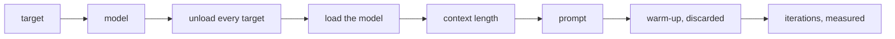
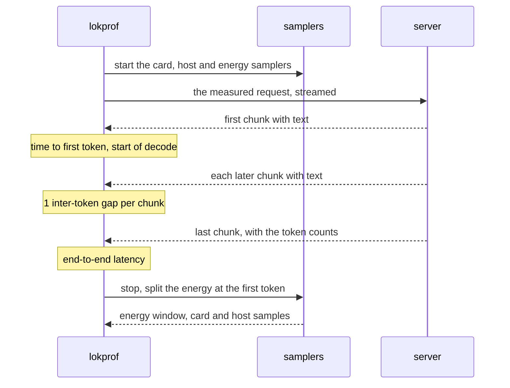

# Concepts

## Targets

A target is a server that lokprof measures.
`--ollama`, `--loken` and `--vllm` each name 1 target by its address.

| Target | Route measured | Label in the output and the record |
|---|---|---|
| Ollama | `/api/generate` | `Ollama` |
| loken | `/api/generate` | the value of `--loken-label`, `LOKEN` by default |
| vLLM | `/v1/completions` | `vLLM` |

A vLLM server holds the model it was launched with.
lokprof neither loads nor unloads it, and the context length is the one set at its launch.

## Sweep and cells

A cell is 1 target, 1 model, 1 context length and 1 prompt.
The sweep measures every cell, target after target, then model after model, then context length after context length, then prompt after prompt.

Before each model, lokprof unloads every model loaded on every target, then loads the model on the target being measured.  
A cell sends its warm-up requests first and discards them, then sends its measured iterations one after the other.

## Prefill and decode

Prefill is the server reading the prompt.
Decode is the server writing the answer, 1 token at a time.

With `--stream`, lokprof times both on its own clock:

| Metric | Measured as |
|---|---|
| Time to first token | from the request to the first chunk that carries text |
| Decode rate | the tokens after the first, over the time from the first token to the last |
| Inter-token latency | the gap between 2 chunks that carry text |

1 streamed iteration runs in this order:

Without `--stream`, no time to first token exists.
The rate is then the tokens over the whole request, prefill included, for every engine alike.

## The same question to every engine

A text prompt reaches every engine unwrapped, with no chat template, as a text to continue.
Decoding is greedy, at temperature 0, and Ollama and loken are asked to turn thinking off.  
A vision prompt keeps the chat template, since it is an instruction about an image.
[Requests](../reference/requests.md) lists what each target receives.

## Energy window

A window is the time of 1 request.
lokprof reads the energy of the whole machine over it: every card, the processor's package, and the memory where the processor reports it.

A window is complete when every card, the processor's package and the memory that the processor reports were read.  
An incomplete window stores no energy figure, and names what could not be read.  
The idle draw of the machine stays inside every figure.
`--idle-energy-secs` records it apart, for you to subtract.

With `--stream`, the window is also split at the first token, and the decode part is measured alone.

## Coherence

A fast answer and a fast wrong answer have the same rate.
lokprof judges every whole answer.
An answer that loops, or that is made of raw byte tokens, fails the cell.  
`--require-substr` adds words that each answer must contain.

## Record

`-o` writes a JSON record of the run: the machine, what each server said of itself, the settings, and every cell with its iterations.
[Record](../reference/record.md) describes every field.

## Terms

| Term | Meaning |
|---|---|
| Target | A server named by `--ollama`, `--loken` or `--vllm` |
| Label | The name of a target in the output and the record |
| Cell | 1 target, 1 model, 1 context length and 1 prompt |
| Sweep | Every cell of a run, target after target |
| Warm-up | Requests sent before the iterations of a cell, and discarded |
| Iteration | 1 measured request of a cell |
| TTFT | Time to first token, on the client's clock, with `--stream` only |
| Decode rate | Tokens after the first, over the time from the first token to the last |
| Window | The time of 1 request, over which the energy is read |
| Domain | A part of the machine whose energy is read: `gpu`, `cpu_pkg`, `dram` |
| Complete window | A window where every card, the processor's package and the memory it reports were read |
| Idle baseline | The draw of the machine with no request, from `--idle-energy-secs` |
| Coherence gate | The check that every answer is a text and holds the expected words |
| Flight | Requests sent together with `--concurrency` |
| Record | The JSON file that `-o` writes |
